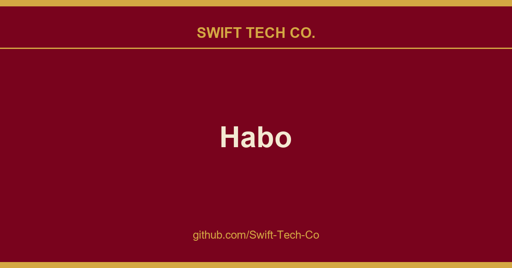

# Habo

## What This Is

A practical reference entry for product and engineering: the Habo notes, examples and fixes we reach for repeatedly. Kept current as part of the wider Swift Tech Co. engineering library.

## Images

[](https://github.com/Swift-Tech-Co/Habo)

## What is Habo?

Habo is a fast, minimalist habit tracker that respects your privacy. No accounts required. No data harvesting. No clutter, just a clean, focused tool for building routines that stick.

**Habo 4.0** ships cross-device sync with end-to-end encryption, automatic encrypted backups, and full self-hosting support. Your habit data is yours, always.

---

## Features

### ☁️ Habo Sync: E2E Encrypted, Zero-Knowledge
Your data is encrypted on your device before it ever leaves it. The server sees only ciphertext: we cannot read your habits, notes, or streaks. Not even if we wanted to.

- Data encrypted locally with your Master Password before upload
- Zero-knowledge architecture: no plaintext ever touches the server
- Device-generated encryption keys
- Automatic encrypted backups: switch phones without losing your history
- **Self-hostable**: run your own Supabase backend, free forever

### 📱 Core Tracking
- **Multiple completion types**: yes/no, numeric, skip (doesn't break streaks)
- **Notes & comments**: add context to each check-in
- **Smart reminders**: gentle nudges at the right time
- **Calendar view**: see streaks and completions on a monthly grid
- **Statistics**: streaks, trends, and completions over time

### 🎨 Personalization
- Dark, Light, and OLED themes
- Material You support (Android)
- Custom button colors
- Drag-and-drop habit reordering
- Categories to group habits by theme

### 🔒 Privacy & Control
- **Offline first**: everything works without an internet connection
- **Biometric lock**: Face ID, Touch ID, or passcode
- **Export & backup**: own your data, always
- **Archive**: pause habits without losing history
- **URL scheme**: deep-link into Habo from Shortcuts and other apps
- **Open source**: GPL-3.0 licensed, auditable, forkable

### 🌍 Translations
Community-contributed translations via Weblate. Want to help bring Habo to your language? Contributions are welcome: no coding required.

---

## Self-Hosting

Habo Sync can run on your own Supabase backend. All sync features are available without a subscription.

> **Self-hosting is free, forever.**

### Prerequisites
- A Supabase account: the free tier is enough
- Node.js (for the Supabase CLI via `npx`)

### Setup

```bash
# 1. Clone the repo
git clone https://github.com/Swift-Tech-Co/Habo
cd Habo

# 2. Link to your Supabase project
npx supabase link --project-ref <your-project-ref>

# 3. Apply database migrations
npx supabase db push

# 4. Deploy the edge function
npx supabase functions deploy delete-account
```

Then in the Habo app: **Settings → Server**, paste your Supabase Project URL and anon key, and tap **Test Connection & Save**.

→ Full details and troubleshooting in [`supabase/README.md`](supabase/README.md)

---

## Building from Source

**Requirements**
- Flutter 3.x
- Dart SDK (bundled with Flutter)
- Android Studio or Xcode for device targets

```bash
git clone https://github.com/Swift-Tech-Co/Habo
cd Habo
flutter pub get
flutter run
```

---

## Contributing

Contributions are welcome and appreciated. Here's how to help:

- **Bug reports & feature requests** → Open an issue
- **Code contributions** → Fork, branch, PR: please open an issue first for large changes
- **Translations** → Join the project on Weblate - no coding required

Please read [CONTRIBUTING.md](CONTRIBUTING.md) before submitting a pull request.

---

## License

Habo is released under the [GNU General Public License v3.0](LICENSE).

---

<div align="center">

**habo.space** &nbsp;·&nbsp; Privacy Policy &nbsp;·&nbsp; Sync

Made with ❤️ by Peter Pavlenko

</div>

---

## Swift Tech Co.

Built and maintained by Swift Tech Co.

AI Automation | FinTech Platforms | Custom Software and Mobile Apps | SaaS Platforms | Cloud Infrastructure | Cybersecurity | SEO and Marketing | API Integration

**Join our community on Telegram:** [t.me/+Qt_eFvkb2rliMzNh](https://t.me/+Qt_eFvkb2rliMzNh)

Home | Services | Careers | Referral Program | Influencers | About | Contact

**Connect**

- Website: https://github.com/Swift-Tech-Co/Habo
- LinkedIn: [linkedin.com/in/stephenoladoke](https://www.linkedin.com/in/stephenoladoke/)
- LinkedIn (Company): [linkedin.com/company/swift-tech-co](https://www.linkedin.com/company/swift-tech-co)
- X: [@MrOladoke](https://x.com/MrOladoke)
- Instagram: [@mr.oladoke](https://www.instagram.com/mr.oladoke/)
- Instagram (Company): [@swifttechco](https://www.instagram.com/swifttechco/)
- Organization: [github.com/Swift-Tech-Co](https://github.com/Swift-Tech-Co)

## Sources

Compiled and maintained from upstream [xpavle00/Habo](https://github.com/xpavle00/Habo) under permissive open-source license.

---

Maintained by [Swift Tech Co.](https://github.com/Swift-Tech-Co) - [Telegram](https://t.me/+Qt_eFvkb2rliMzNh)

## Sources

Compiled and maintained from upstream [xpavle00/Habo](https://github.com/xpavle00/Habo) under permissive open-source license.

---

Maintained by [Swift Tech Co.](https://github.com/Swift-Tech-Co) - [Telegram](https://t.me/+Qt_eFvkb2rliMzNh)

## Sources

Compiled and maintained from upstream [xpavle00/Habo](https://github.com/xpavle00/Habo) under permissive open-source license.

---

Maintained by [Swift Tech Co.](https://github.com/Swift-Tech-Co) - [Telegram](https://t.me/+Qt_eFvkb2rliMzNh)